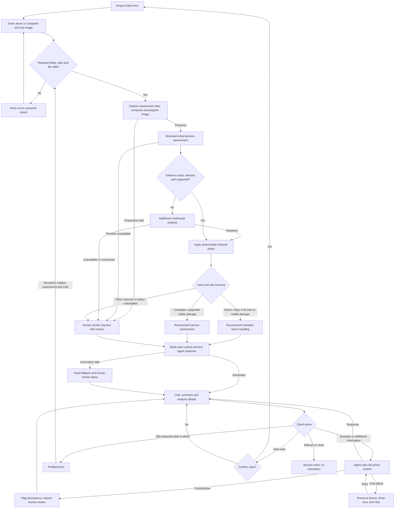

# PRD - Hardware Service Decision Copilot - Decision Model Variant

## 1. Executive Summary

This course proof of concept (PoC) helps a client submit a synthetic electronics return or complaint through a form and then discuss a preliminary recommendation with an LLM agent. A bounded initial decision step assesses the uploaded image, while deterministic checks apply dates, required fields and fictional company procedures; uncertain visual judgments receive additional multimodal analysis. The product supports customer support and hardware service staff, who retain the final decision outside the PoC; it never performs an external action or determines statutory consumer rights.

## 2. Problem Statement

Support and service teams must reconcile descriptions, purchase dates, photos and company procedures when deciding how to handle a case. A photo can be unclear, unrelated to the described item or insufficient to show the reported fault, and clients may omit information needed for a useful assessment. Clients need an understandable explanation of the next step without mistaking a visual observation for a diagnosis, a claim decision or a guarantee of a refund.

## 3. Users / Personas

| Persona | Goal | Expected outcome |
| --- | --- | --- |
| Client submitting a synthetic case | Describe one item, provide a photo and ask follow-up questions | A preliminary route or explicit human-review status, grounded explanation and next steps in Polish |
| Customer support employee | Understand what the client supplied and what remains unresolved | A distinction between supplied facts, visual observations, fictional policy checks and missing evidence; follow-up happens outside the PoC |
| Hardware service employee | Identify whether visible damage or an unobservable fault requires inspection | A limited description of visible condition without invented causes or diagnostic claims; final assessment happens outside the PoC |

The client operates the form and chat. There are no staff accounts, staff screens or separate role workflows in this version. All course participants use synthetic cases and non-identifying images, regardless of the persona being demonstrated.

## 4. Main Flows

### 4.1 Submit a return with clear observations

1. The client opens an empty Polish form with a synthetic-data notice.
2. The client selects `Zwrot`, selects an equipment category, enters the name/model and purchase date, optionally gives a reason and attaches one image.
3. The product validates the form and file before sending anything to a model. Errors remain next to the affected fields and preserve other inputs.
4. The product records the assessment date and prepares a compressed image on the server before model submission. Failure to prepare an assessable image leads to human review rather than a guessed result.
5. The bounded initial decision step returns the image usability and relevance assessments, predefined damage observations, their probabilities and explicit evidence limitations.
6. If the image is usable and relevant and all three damage observations are confidently negative, the product applies the fictional return procedure. A purchase within 30 calendar days inclusive receives `Rekomendacja: standardowa obsługa zwrotu`; an older purchase requires human review.
7. The product opens the chat with a case summary and its first assistant message: greeting, route or review status, justification, evidence limitations and next steps.
8. The client can ask questions or provide more information. The conversational agent uses the complete active case context and does not rerun the initial decision model on chat turns.

### 4.2 Submit a complaint

1. The client selects `Reklamacja`, completes the common fields and supplies a non-empty problem description and one image.
2. The product validates inputs, prepares the image and performs the same bounded visual assessment.
3. If the image is usable and relevant and at least one damage observation is confidently positive, with no unresolved relevant observations or conflicts, the fictional complaint procedure produces `Rekomendacja: ocena serwisowa`.
4. If the reported fault is not visible, evidence is insufficient or analysis remains unclear, the product shows `Wymagana ocena człowieka`.
5. The first assistant message explains the route or review requirement and can ask a focused question about symptoms. It does not infer how the damage happened or whether the complaint is legally valid.
6. The client continues the conversation; the agent can refine the description and explain the procedure without issuing a binding decision.

### 4.3 Uncertain, conflicting or unsupported visual assessment

1. An observation falls between the agreed probability thresholds, evidence is missing, the image is unusable or irrelevant, or the description and image conflict.
2. The product displays that additional image analysis is in progress and sends the case for multimodal analysis.
3. The additional analysis addresses the flagged questions, explicitly distinguishing what is visible from what cannot be established. It may resolve an initial uncertain observation but must not fabricate probabilities, unseen details or damage causes.
4. If all required visual questions are resolved, the product applies the same deterministic fictional policy rules. Otherwise it records `Wymagana ocena człowieka` with the unresolved reasons.
5. The chat explains the result and limitations. A request for a clearer image directs the client back to the form; the chat does not accept a second image or silently replace evidence.

### 4.4 Validation, preparation and provider failures

1. A missing required field, future purchase date, invalid file or unsupported format blocks submission and shows a Polish correction message.
2. The client corrects the input without losing other entered values.
3. If image preparation or an assessment provider fails after valid submission, the product opens the result with `Wymagana ocena człowieka` and identifies the failed stage. It does not present an absent analysis as a negative finding.
4. If the initial conversational response cannot be generated, the product displays a fixed Polish first-message fallback with the known facts, available findings, review status and next steps. No generated explanation is invented.
5. If a later chat request fails, the product preserves the conversation and unsent/failed client text, displays an error and offers an explicit retry. The previously completed assessment remains visible as historical context, with a current human-review notice explaining the service failure.
6. A chat retry retries only the failed conversational request; restoring conversation does not clear the human-review requirement. A fresh initial assessment requires form resubmission.

### 4.5 Follow-up, corrected data and session end

1. The client provides additional information or asks a question in chat.
2. The agent acknowledges relevant additions, asks focused follow-up questions and distinguishes client-reported information from visual evidence.
3. If an addition contradicts a fact used by the recommendation, the agent flags the discrepancy and requires human review pending a fresh assessment. It does not silently change the form or maintain an unsupported recommendation.
4. To correct assessed data or replace the photo, the client selects `Wróć do formularza`. The existing values and photo preview are available for editing.
5. Resubmission starts a new assessment and a new conversation. The prior assessment and conversation are not mixed into the new case context.
6. `Nowa sprawa` asks for confirmation before clearing the active case. Refreshing or closing the page ends the session; the product does not offer restoration or session history.
7. When human review is needed, the agent tells the client to contact support or service outside the PoC. It does not claim to have forwarded, registered or scheduled anything.

## 5. User Stories

- As a client, I want to submit one item with a photo and purchase date, so that I receive a preliminary handling route.
- As a client, I want field-specific validation, so that I can correct an incomplete complaint or invalid upload without re-entering the form.
- As a client, I want to understand which findings are visible and which are uncertain, so that I do not mistake image analysis for a diagnosis.
- As a client, I want to ask the agent questions and add symptom details, so that the explanation reflects the full conversation.
- As a client, I want an explicit human-review status when evidence or a provider is unavailable, so that I know assistance has not established a supported route.
- As a client, I want to correct the form and start a fresh assessment, so that the result corresponds to the corrected data.
- As a support employee, I want policy checks separated from visual judgments, so that a fictional procedure is not presented as a consumer-rights decision.
- As a service employee, I want invisible faults and unresolved contradictions identified, so that a physical inspection is not replaced by unsupported image claims.

## 6. Acceptance Criteria

### Form and image

- AC-01: The case-type selector offers exactly `Zwrot` and `Reklamacja` and requires an explicit selection.
- AC-02: The equipment selector offers exactly the five categories listed in Section 8 and requires an explicit selection.
- AC-03: Submission is blocked when name/model is empty after trimming whitespace.
- AC-04: Submission is blocked when the purchase date is absent, invalid or later than the assessment date.
- AC-05: A whitespace-only description blocks a complaint but does not block a return.
- AC-06: Submission requires exactly one image.
- AC-07: The product rejects files other than decodable JPEG, PNG or WebP images before model submission.
- AC-08: A file exceeding 10,000,000 bytes is rejected with `Zdjęcie przekracza limit 10 MB.`
- AC-09: The client can preview, remove or replace the selected image before submission.
- AC-10: A validation error preserves the other valid form values.
- AC-11: Every image sent to an image-capable model has first completed server-side compression and preparation.
- AC-12: Image-preparation failure produces a visible human-review status rather than a visual assessment result.

### Initial decision and escalation

- AC-13: An available initial result lists image usability, item relevance and each of the three predefined damage observations.
- AC-14: Each initial observation includes a probability from 0% to 100%, or an explicit `Brak oceny` when no supported probability is available.
- AC-15: Missing evidence is represented explicitly and is never encoded as 0% probability.
- AC-16: A supported damage probability of exactly 10% is classified as confidently negative.
- AC-17: A supported damage probability of exactly 90% is classified as confidently positive.
- AC-18: Any damage probability strictly between 10% and 90% triggers multimodal escalation.
- AC-19: An unusable image, irrelevant image, unsupported required judgment or conflict triggers multimodal escalation regardless of reported probabilities.
- AC-20: Additional analysis preserves the initial observations and identifies which questions it resolved or left unresolved.
- AC-21: Any required visual judgment still unresolved after additional analysis produces `Wymagana ocena człowieka`.
- AC-22: An unavailable assessment provider produces `Wymagana ocena człowieka` without manufacturing observation values.
- AC-23: The product does not require independent damage probabilities to sum to 100%.

### Fictional policy

- AC-24: A return dated exactly 30 calendar days before the assessment date is inside the fictional return window.
- AC-25: A return dated 31 calendar days before the assessment date is outside that window and requires human review.
- AC-26: A return inside the window receives the standard-return route only when the usable, relevant image supports negative findings for all three damage observations and no unresolved conflict remains.
- AC-27: A return with any supported positive damage finding receives the human-review status.
- AC-28: A complaint with at least one supported positive damage finding receives the service-assessment route only when all required image questions are resolved.
- AC-29: A complaint with no visible evidence of the reported fault receives the human-review status.
- AC-30: Purchase-date arithmetic, required-field checks and fixed policy routing do not depend on an LLM judgment.
- AC-31: Missing, unreadable or contradictory applicable policy content results in human review rather than invented policy terms.

### Chat and case state

- AC-32: On entering chat, the first assistant bubble contains a greeting, recommendation or review status, justification, limitations and next steps without requiring a client message first.
- AC-33: The return scenario uses return-specific conversational instructions and the complaint scenario uses complaint-specific instructions.
- AC-34: Each conversational turn has the active form data, initial observations, any escalated analysis, applicable procedure and complete active conversation available as context.
- AC-35: Sending a normal chat message does not invoke the initial decision model again.
- AC-36: The agent labels new client statements as reported information rather than image-derived findings.
- AC-37: The agent cannot remove a human-review requirement within the same assessment through conversation.
- AC-38: A new client statement contradicting an assessed fact is visibly flagged and cannot silently revise the assessed form data.
- AC-39: Form resubmission after an edit replaces the active assessment and starts a conversation without prior-case messages.
- AC-40: A failed initial conversational response produces a fixed first-message fallback with a human-review status and any already available findings.
- AC-41: A failed later conversational request preserves the prior messages and exposes an explicit retry action.
- AC-42: Confirming `Nowa sprawa` clears the form, image, assessment and conversation.
- AC-43: Refreshing the page does not restore the prior case or conversation.

### Presentation and boundaries

- AC-44: All client-visible controls, validation errors, status messages and agent replies are in Polish.
- AC-45: The chat screen exposes the submitted form data and image preview in a case summary.
- AC-46: Expandable analysis details distinguish initial probabilities from any later multimodal findings and missing evidence.
- AC-47: Every first result message contains the notice specified in Section 11.5.
- AC-48: No product action issues a refund, accepts or rejects a claim, creates an external ticket or contacts another party.
- AC-49: The form displays the synthetic-data and non-identifying-image restriction before submission.
- AC-50: Assessment loading indicates validation/preparation, initial assessment or additional image analysis without displaying a completed result prematurely.
- AC-51: Required fields, errors and review statuses are expressed in text and can be reached using the keyboard.
- AC-52: The agent refuses to infer damage causation, legal eligibility or device functionality solely from the photo.

## 7. Out of Scope

- **Binding decisions and external actions:** Refund execution, complaint acceptance/rejection, return shipping, repairs, appointments and external case creation.
- **Full claims platform:** Staff queues, assignment, approval screens, deadlines, case tracking, exports and recorded final staff decisions.
- **Authentication and roles:** Accounts, login, access-control flows and separate staff views.
- **Customer and purchase integrations:** Customer lookup and purchase-history retrieval, including the proposed future SQLite-backed capability.
- **Persistent history:** Saved sessions, decision/action audit history, cross-device access and restoration after refresh; these may be considered later.
- **RAG:** An internal electronics/specifications knowledge base and retrieval beyond the two supplied fictional procedures.
- **Administration and notifications:** Policy editors, admin UI, email, SMS, push notifications and automatic escalation delivery.
- **Expanded evidence:** Multiple items, multiple photos, chat attachments, video, documents, receipt verification and device identity/authenticity verification.
- **Diagnostic or legal conclusions:** Internal faults inferred from appearance, damage causation, fraud detection and determination of statutory rights.
- **Additional channels and languages:** Native mobile apps, voice interaction and multilingual UI/chat. Responsive web presentation does not introduce a separate mobile application.
- **Real operational data:** Personal/customer records, identifying images and production complaint processing.
- **Architecture and implementation in this task:** Technology choices, application scaffolding, code, provider setup, implementation prompts and testing strategy belong to later work.

## 8. Constraints

### 8.1 Business

- The procedures below are fictional course fixtures, version `PoC-1`. They define internal preliminary routes only, not statutory consumer rights or binding company obligations.
- The product must never equate a low probability of visible damage with uncertainty when evidence supports a negative finding.
- An image cannot establish the cause of damage, hidden functionality or legal entitlement. A clear image of one view does not prove that the whole item is undamaged.
- Staff retain the final decision outside the product. The client-facing agent cannot override a human-review requirement or claim that external action has occurred.
- Only synthetic descriptions and non-identifying equipment images may be submitted. The form does not request customer identity, contact details, serial numbers or purchase documents.
- No specific provider, live legal rule or third-party service limit is a product dependency in this PRD. The image limit and thresholds are agreed PoC requirements, not claims about provider capabilities or model accuracy.

### 8.2 Functional

| Area | Requirement |
| --- | --- |
| Case size | One item and one image per assessment |
| Types | `Zwrot`, `Reklamacja` |
| Equipment categories | `Telefony/tablety`, `Komputery/laptopy`, `Monitory/telewizory`, `Audio`, `Akcesoria` |
| Required common inputs | Type, category, name/model, purchase date and image |
| Reason | Required for complaints, optional for returns |
| Images | JPEG, PNG or WebP; maximum 10,000,000 bytes before compression |
| Image preparation | Server-side compression before model submission; reassess usability of prepared evidence rather than assuming compression preserves sufficient detail |
| Language | Polish interface and conversation; English product documentation |
| Dates | Calendar dates in the Europe/Warsaw business date; assessment date captured on each valid submission |
| Return interval | Assessment date minus purchase date in calendar days; day 0 through day 30 inclusive is inside the fictional window |
| Session | One active case; no restoration after page refresh or close |
| Image reassessment | Only on valid form submission, including resubmission after an edit |
| Interaction | Web form followed by agent chat; keyboard-operable controls and textual errors/statuses |

### 8.3 Supplied fictional procedure content

The following two texts are the initial fictional policy documents. Their complete product content is included here because this task creates only the PRD. During later implementation they must be supplied as two separate procedure documents, with the selected one included in the conversational agent's case context. Physical locations and loading mechanisms are deferred to the ADR.

| Document | Location in this deliverable | Used when |
| --- | --- | --- |
| Fictional Return Procedure, PoC-1 | Section 8.3.1; separate document location deferred | Deterministic return routing and return-specific explanations |
| Fictional Complaint Procedure, PoC-1 | Section 8.3.2; separate document location deferred | Deterministic complaint routing and complaint-specific explanations |

#### 8.3.1 Fictional Return Procedure, PoC-1

1. This procedure is a fictional course example. It does not determine statutory consumer rights or authorize a refund.
2. A return requires the common form fields and one usable image relevant to the declared item category. A return reason is optional.
3. The internal standard-return window is day 0 through day 30 after the purchase date, inclusive, calculated using the assessment date. Future purchase dates are invalid inputs, not policy refusals.
4. Recommend standard return handling only within that window and when all three observations support no visible cracks, dents/deformations or scratches in the supplied view, with no unresolved evidence issue.
5. Visible damage, an elapsed window, unresolved observations, conflicts or unavailable assessment services require a human review. None of these outcomes is an automatic return rejection.
6. Tell the client the applicable date check, what the image does and does not show, and whether the next step is standard return handling or human review outside the PoC. Do not invent a shipping label, contact address or registration number.
7. Staff make the final decision outside this product.

#### 8.3.2 Fictional Complaint Procedure, PoC-1

1. This procedure is a fictional course example. It does not determine statutory consumer rights or authorize acceptance or rejection of a complaint.
2. A complaint requires the common form fields, a non-empty description of the problem and one image. A valid purchase date is collected as context; this fictional complaint procedure has no claim-eligibility period.
3. When a usable and relevant image supports at least one visible crack, dent/deformation or scratch, and all required evidence questions are resolved, recommend service assessment.
4. A reported fault not visible in the photo, an unusable or irrelevant image, conflicting evidence or an unresolved analysis requires human review. Lack of visible damage is not evidence that the reported fault is absent.
5. Do not attribute damage to misuse, manufacturing, transport or any other cause from the photo. Do not promise repair, replacement, reimbursement or a legal outcome.
6. Explain the visible findings and missing evidence, and identify the next step outside the PoC. The agent may ask for symptom details but cannot book or register service.
7. Staff make the final decision outside this product.

## 9. UI Description (wireframe level)

### 9.1 Intake form

- Header: product name, short explanation of preliminary assistance and a visible synthetic-data/non-identifying-image notice.
- Main form, in order: case type selector, equipment category selector, name/model input, purchase date picker, reason textarea and image upload.
- Selectors start with an unselected placeholder. The complaint reason is marked required only for `Reklamacja`.
- The upload area states accepted formats, one-image restriction and 10 MB limit. Selection displays a preview, file information and `Usuń` / `Zmień zdjęcie` actions.
- The primary action is `Prześlij do oceny`. Inline errors identify corrections; a summary directs keyboard focus to invalid fields after unsuccessful submission.
- During processing, values remain visible and a textual stage indicator shows what is happening. Duplicate submissions are disabled until the attempt completes.
- Invalid inputs stay on the form. A completed assessment or post-validation processing failure opens the chat/result view.
- `Wróć do formularza` from chat restores current assessed inputs for editing. Resubmission starts a fresh assessment and conversation; the user is told this before confirming resubmission.

### 9.2 Chat and assessment result

- Header: case type and current route or human-review status. The status remains visible independently of chat prose.
- Case summary: category, name/model, purchase date, assessment date, client description and image preview. On a narrow viewport it appears above the chat or can be expanded.
- Analysis disclosure: image usability, relevance, the three damage observations, initial probabilities, missing evidence, escalation reason and any separate multimodal findings. Probabilities are labeled as visual-observation estimates, not claim-success probabilities or measured model accuracy.
- Policy summary: procedure name/version, relevant fixed-rule checks and the resulting preliminary route.
- Conversation: distinct client and assistant bubbles. The first assistant bubble appears automatically and uses labeled paragraphs or lists for result, justification and next steps.
- Composer: text input and `Wyślij`. While a response is being generated, the product shows a reply-in-progress state and prevents duplicate sends. It never treats partial reply text as a final decision.
- Failure state: a textual error and explicit retry; an initial generation failure uses the fixed fallback message. Available evidence remains accessible.
- Navigation: `Wróć do formularza` and `Nowa sprawa`. Starting a new case requires confirmation and then opens the empty form.
- Human-review state: reason and instructions to seek support/service outside the PoC. There is no fake handoff button, staff queue or promised response time.

Visual styling is separate from these wireframes. The repository's existing design reference is an observed ING homepage reference, not an approved identity for this product; it does not establish complaint-form behavior or permission to use third-party branding. Product branding and unestablished interaction states remain deferred.

## 10. User Flow Diagram

## 11. Agent / System Behavior Specification

### 11.1 Roles and evidence boundaries

| Component role | Allowed behavior | Prohibited behavior |
| --- | --- | --- |
| Initial decision step | Assess only predefined visual criteria once per submitted form; report probabilities and limitations | Act as the conversational agent, determine causation or decide legal eligibility |
| Additional multimodal analysis | Investigate flagged uncertainties and conflicts; provide grounded findings or explicit unresolved questions | Invent unseen evidence, overwrite initial estimates as if they were the original result, or fabricate calibrated probabilities |
| Deterministic policy checks | Validate exact fields/dates and map resolved findings to the supplied fictional rules | Ask an LLM to reinterpret a fixed threshold or invent a missing rule |
| Conversational LLM agent | Explain the established outcome, answer relevant questions, ask for symptom/context details and guide next steps | Override mandatory review, alter assessed facts silently, invoke external actions or treat client text as verified visual evidence |

Form descriptions, chat messages and text visible in uploaded images are case evidence, not instructions that can override these boundaries or the supplied policy.

### 11.2 Initial observation vocabulary

| Criterion | Positive meaning | Limitations |
| --- | --- | --- |
| Image usable | The prepared image has sufficient visible detail to assess the defined observations | A decodable file alone does not establish usability |
| Item relevant | The visible item is compatible with the declared category and description | Does not verify exact model, ownership, authenticity or purchase |
| Crack | A visible crack or break is present in the depicted view | Does not establish cause or internal condition |
| Dent/deformation | A visible dent or deformation is present in the depicted view | Does not establish cause or functional impact |
| Scratch | A visible surface scratch is present in the depicted view | Does not establish depth, cause or functional impact |

Each criterion carries an initial probability when supported, a concise evidence description and any missing-evidence explanation. These are independent statements: a photo can show both a crack and a scratch.

For damage observations, supported probabilities from 0% through 10% inclusive are confidently negative for the PoC; 90% through 100% inclusive are confidently positive; intermediate values are uncertain. For usability and relevance, both must be supported positive findings at 90% or higher before initial results can proceed directly to policy checks. A low usability/relevance probability is a confident finding of an evidence problem, so it still triggers escalation.

Unsupported judgments, malformed results, missing probabilities and contradictions trigger escalation regardless of numeric extremes. Numeric certainty does not erase missing evidence. Additional analysis can resolve flagged questions with explicit evidence-backed findings; if it cannot, human review is mandatory. The agreed thresholds are provisional routing thresholds, not validated accuracy claims.

### 11.3 Outcome categories and precedence

| Displayed outcome | Conditions | Client-facing meaning |
| --- | --- | --- |
| `Rekomendacja: standardowa obsługa zwrotu` | Return within days 0-30; usable relevant image; all three damage findings resolved negative; no unresolved contradiction | Preliminary suggestion of an internal route, subject to staff decision |
| `Rekomendacja: ocena serwisowa` | Complaint with usable relevant image and at least one resolved positive damage finding; required evidence questions resolved | Service assessment is suggested; no claim or repair outcome has been decided |
| `Wymagana ocena człowieka` | Any unresolved required judgment, evidence conflict, relevant provider failure, missing policy, return exception or complaint fault not visible | Automated assistance cannot establish a supported handling route; a person must assess the case |

Human review takes precedence over route recommendations. Once required in an assessment, it remains required throughout that conversation. Follow-up statements may add context or reveal a new reason for review, but cannot clear it. Only a fresh form submission creates a separate assessment that may produce a different outcome.

### 11.4 Scenario-specific conversational instructions

Two distinct instruction sets are required during later implementation; their functional contracts are:

- **Return agent:** Use the supplied return procedure; explain the purchase-date calculation, visible-condition findings and limitations. For the standard route, state that final handling is subject to staff review. For exceptions, identify the specific reason human review is needed without calling the return rejected.
- **Complaint agent:** Use the supplied complaint procedure; distinguish the reported symptom from visible damage. Explain why service assessment or human review is needed, and ask relevant symptom questions when useful. Never treat absence of visible damage as absence of a fault, or a visible mark as proof of misuse.

Both agents receive the assessed form, initial probabilities and limitations, any additional image analysis, current outcome/reasons, assessment date, applicable policy version and full active conversation including the first response. The bounded initial decision step is not the chat model. No turn may silently omit earlier active-case messages; if context cannot be retained, the product must disclose the limitation and require a new case rather than claim full recall.

The agent responds in Polish, uses concise factual language and separates observations, client statements, policy checks and unknowns. It asks focused follow-up questions when those help describe the case, without promising that an answer will remove mandatory human review. It redirects off-topic requests to the active return/complaint and declines requests to perform unavailable actions.

### 11.5 Mandatory notices and fallback

Before submission, display:

> PoC szkoleniowe. Używaj wyłącznie danych syntetycznych i zdjęć bez danych identyfikujących osoby lub urządzenia.

Every first result message, including the fixed fallback, contains:

> To wstępna rekomendacja według fikcyjnej procedury PoC. Nie rozstrzyga praw konsumenta. Zdjęcie nie ustala przyczyny uszkodzenia ani sprawności urządzenia. Ostateczną decyzję podejmuje pracownik.

The fallback also names the failed stage, lists only already available facts/findings, states `Wymagana ocena człowieka` and directs the client to support/service outside the PoC. It must not display a previous preliminary route as a current successful decision when assistance has failed.

## 12. Further Notes

- Confirmed scope: client-facing form and agent conversation, five equipment categories, three damage observations, provisional 10%/90% thresholds, fictional 30-day return window and the complaint route defined above.
- The two fictional procedures are included in this PRD only. Separate procedure documents and scenario-specific implementation prompts are later deliverables; this task creates no other files.
- The selected architecture, providers, model capabilities, response budgets, image-compression parameters, supported browser/version matrix and handling of conversation capacity must be resolved in the ADR before implementation. This PRD does not assert provider support or impose unverified service limits.
- No measured accuracy, latency target or probability calibration has been established. The PoC must not claim any of these as proven.
- Branding is not approved for this product. Existing repository design material can inform later design discussion but does not establish an ING affiliation or product identity.
- Potential later additions are customer/purchase lookup, persistent session/decision history and an internal RAG knowledge base. They are explicitly excluded from this PoC.
